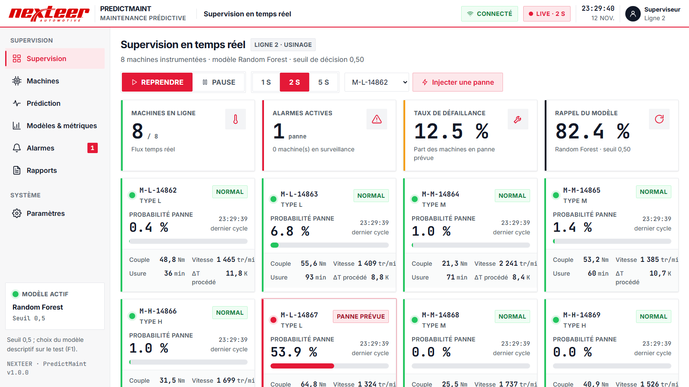

# PredictMaint

**Maintenance prédictive temps réel pour un parc de machines industrielles.**
API FastAPI + interface React/Vite/Tailwind inspirée des HMI Nexteer, alimentée par le jeu de données **UCI AI4I 2020** et un modèle **Random Forest**.

> **Seuil 0,5 ; choix du modèle descriptif sur le test (F1).**



---

## Sommaire

- [Fonctionnalités](#fonctionnalités)
- [Architecture](#architecture)
- [Démarrage rapide](#démarrage-rapide)
- [Captures](#captures)
- [API REST](#api-rest)
- [Flux temps réel](#flux-temps-réel)
- [Modèle & métriques](#modèle--métriques)
- [Tests & vérification](#tests--vérification)
- [Données & artefacts](#données--artefacts)
- [Notes et choix](#notes-et-choix)

---

## Fonctionnalités

- **8 pages HMI** : Supervision, Machines, Prédiction, Modèles, Alarmes, Rapports, Paramètres, Journal API.
- **Temps réel** : WebSocket `/ws/live` (repli SSE `/api/stream`), poussée toutes les **2 s**, reconnexion automatique avec back-off exponentiel.
- **Simulateur industriel** : 8 machines (3 L, 3 M, 2 H), épisodes de dégradation progressifs construits à partir de mesures réelles de panne, injection de panne de **45 s**.
- **Persistance SQLite** : mesures, alarmes et transitions d'état conservées dans `data/predictmaint.db`.
- **API REST documentée** : validation Pydantic, `/docs` interactif, historique par machine, prédiction unitaire et par lot (100 machines max).
- **Restitution du modèle** : comparaison des 5 modèles, matrices de confusion, courbes ROC/PR, importance des variables, exports CSV/PNG/ZIP.
- **Thème HMI clair** : panneaux blancs, sidebar `#F7F7F8`, en-têtes `#F3F4F6` soulignés de rouge Nexteer `#E41937`, valeurs numériques en monospace, code couleur vert / orange / rouge.
- **100 % hors-ligne** : aucune police, image ou librairie chargée depuis un CDN.

### Codes couleur métier

| Statut | Règle | Couleur |
|---|---|---|
| `NORMAL` | probabilité < 0,35 | vert |
| `SURVEILLANCE` | 0,35 ≤ probabilité < 0,50 | orange |
| `PANNE_PREVUE` | probabilité ≥ 0,50 | rouge |

---

## Architecture

```text
predictmaint/
├── backend/
│   ├── main.py            # FastAPI, REST, WebSocket, SSE, fichiers statiques
│   ├── schemas.py         # validation Pydantic (capteurs, lots, simulateur)
│   ├── service.py         # chargement joblib, prédiction, artefacts, métriques
│   ├── simulator.py       # 8 machines, dégradation, injection, diffusion live
│   ├── db.py              # SQLite : mesures, alarmes, historique
│   └── tests/test_api.py  # 7 tests pytest
├── frontend/
│   ├── src/               # React 18, Vite, Tailwind, Recharts, Lenis
│   ├── public/assets/     # logo Nexteer
│   └── dist/              # build de production servi par FastAPI
├── data/
│   └── ai4i2020.csv       # jeu UCI AI4I 2020 (10 000 lignes)
├── resultats_projet/      # modèle retenu, métriques, matrices, courbes, figures
├── captures/              # captures d'écran + rapport de vérification
├── train_export.py        # réentraînement + export des artefacts
├── verify_ui.py           # vérification Playwright des 8 pages
└── requirements.txt
```

Flux de données :

```text
Capteurs simulés ──► Simulateur (2 s) ──► Pipeline Random Forest ──► Statut
       │                                       │
       └────────── SQLite ◄───────────────────┘
                                                   │
                        WebSocket /ws/live ◄───────┘
                        SSE /api/stream  ◄─────────┘
                                 │
                          Dashboard React
```

---

## Démarrage rapide

### Prérequis

- Python **3.11+** (testé avec 3.14)
- Node.js **18+** (testé avec 24) et npm
- Le fichier `data/ai4i2020.csv` (déjà présent)

### Installation

```powershell
cd predictmaint
python -m venv .venv
.\.venv\Scripts\Activate.ps1
pip install -r requirements.txt
```

### Réentraînement (facultatif)

Les artefacts sont déjà fournis dans `resultats_projet/`. Pour les régénérer :

```powershell
python train_export.py
# options : --data data/ai4i2020.csv --out resultats_projet
```

Le script rejoue le protocole : split stratifié 80/20 (8 000 / 2 000), SVMSMOTE sur le train uniquement, comparaison de 5 modèles, seuil 0,5, export du modèle retenu et des métriques.

### Lancement production (recommandé)

```powershell
cd predictmaint
python -m uvicorn backend.main:app --host 127.0.0.1 --port 8000
```

- Interface : <http://127.0.0.1:8000/>
- Documentation API : <http://127.0.0.1:8000/docs>
- Démarrage : environ 7 s (chargement du modèle + scoring des scénarios à risque).

Le serveur sert directement `frontend/dist`. Toute modification du frontend nécessite un rebuild :

```powershell
cd frontend
npm install
npm run build
```

### Développement frontend

Deux terminaux :

```powershell
# Terminal 1 — API
python -m uvicorn backend.main:app --reload --port 8000

# Terminal 2 — Vite
cd frontend
npm run dev
```

Vite écoute sur <http://127.0.0.1:5173> et proxifie `/api`, `/files` et `/ws` vers le port 8000.

### Variables d'environnement

| Variable | Défaut | Rôle |
|---|---|---|
| `PREDICTMAINT_DB` | `data/predictmaint.db` | chemin de la base SQLite |
| `PREDICTMAINT_SIMULATOR` | `1` | `0` désactive le simulateur (utile en test) |
| `PREDICTMAINT_INTERVAL` | `2` | intervalle de tick en secondes |

---

## Captures

| Supervision | Parc machines |
|---|---|
|  |  |

| Modèles & métriques | Prédiction unitaire |
|---|---|
|  |  |

| Journal des alarmes | Rapports & exports |
|---|---|
|  |  |

| Paramètres | Journal API |
|---|---|
|  |  |

| Résultat de prédiction | Vue tablette |
|---|---|
|  |  |

Le rapport `captures/rapport_verification.json` atteste : 0 erreur console, 8 cartes machine, 4 KPI, injection et formulaire de prédiction fonctionnels.

---

## API REST

| Méthode | Endpoint | Description |
|---|---|---|
| `GET` | `/api/health` | état API, modèle, seuil, uptime, simulateur |
| `GET` | `/api/system/info` | métadonnées modèle, dataset, chemins |
| `GET` | `/api/logs?limit=100` | journal des appels `/api` |
| `POST` | `/api/predict` | prédiction unitaire |
| `POST` | `/api/predict/batch` | prédiction par lot (1 à 100 machines) |
| `GET` | `/api/models/comparison` | comparaison des 5 modèles |
| `GET` | `/api/models/metrics` | métriques du modèle retenu |
| `GET` | `/api/models/confusion/{model}` | matrice de confusion |
| `GET` | `/api/models/importance` | importance par permutation |
| `GET` | `/api/models/roc` | courbes ROC comparées |
| `GET` | `/api/models/pr` | courbes précision-rappel |
| `GET` | `/api/models/bilan` | bilan métier + équilibrage SVMSMOTE |
| `GET` | `/api/machines` | état live des 8 machines |
| `GET` | `/api/machines/{id}/history?limit=120` | historique SQLite (`limit` ≥ 10) |
| `GET` | `/api/alarms?limit=100&severity=&machine_id=` | alarmes filtrables |
| `GET` | `/api/simulator/status` | état du simulateur |
| `POST` | `/api/simulator/control` | pause / reprise / intervalle 1, 2 ou 5 s |
| `POST` | `/api/simulator/inject/{machine_id}` | injection de panne (45 s) |
| `WS` | `/ws/live` | flux temps réel |
| `GET` | `/api/stream` | repli SSE |
| `GET` | `/api/reports/zip` | archive ZIP de `resultats_projet/` |
| `GET` | `/files/{fichier}` | artefacts statiques (CSV, PNG) |
| `GET` | `/docs` | Swagger UI |

### Exemple — prédiction unitaire

```powershell
curl -X POST http://127.0.0.1:8000/api/predict `
  -H "Content-Type: application/json" `
  -d '{"type":"L","air_temperature":298.1,"process_temperature":308.6,"rotational_speed":1300,"torque":70.0,"tool_wear":240}'
```

Réponse :

```json
{
  "probability": 0.951,
  "prediction": 1,
  "status": "PANNE_PREVUE",
  "threshold": 0.5,
  "latency_ms": 18.4,
  "machine_id": null,
  "timestamp": "2026-11-12T23:02:00+00:00",
  "derived": { "delta_temperature": 10.5, "power_proxy": 9528.91 }
}
```

### Validation Pydantic

- `type` ∈ `L`, `M`, `H`
- Températures : 250–350 K (air), 250–360 K (procédé)
- Vitesse : 500–4 000 tr/min ; couple : 0–150 Nm ; usure : 0–300 min
- Température procédé **strictement supérieure** à la température air
- Lots : 1 à 100 machines

---

## Flux temps réel

Le WebSocket envoie d'abord un **snapshot**, puis à chaque tick :

1. un événement `machine` par machine (mesures, probabilité, statut) ;
2. les éventuels événements `alarm` lors des transitions d'état ;
3. un événement `tick` agrégé (latence, nombre de machines, taux de panne, probabilité max/moyenne).

Les prédictions manuelles sont diffusées via `manual_prediction`. En cas de coupure, le client retente avec un back-off exponentiel (1 s → 30 s) puis bascule sur SSE si nécessaire. Les contrôles pause / intervalle sont disponibles depuis la page Paramètres.

Exemple de message agrégé :

```json
{
  "type": "tick",
  "timestamp": "2026-11-12T23:02:08+00:00",
  "latency_ms": 110.46,
  "interval": 2,
  "paused": false,
  "online": 8,
  "alarm_count": 2,
  "watch_count": 1,
  "failure_rate": 0.25,
  "max_probability": 0.9875,
  "avg_probability": 0.1832
}
```

---

## Modèle & métriques

Protocole : split stratifié 80/20, **SVMSMOTE appliqué au train uniquement**, seuil de décision **0,5**, graine 42.

| Modèle | Accuracy | Précision | Rappel | F1 | ROC-AUC | Avg. Precision |
|---|---:|---:|---:|---:|---:|---:|
| Logistic Regression | 0,9010 | 0,2314 | 0,8235 | 0,3613 | 0,9188 | 0,4426 |
| SVM RBF | 0,9595 | 0,4496 | 0,8529 | 0,5888 | 0,9677 | 0,6956 |
| **Random Forest** | **0,9880** | **0,8235** | **0,8235** | **0,8235** | **0,9741** | **0,8653** |
| XGBoost | 0,9825 | 0,7089 | 0,8235 | 0,7619 | 0,9667 | 0,8804 |
| MLP | 0,9700 | 0,5392 | 0,8088 | 0,6471 | 0,9720 | 0,7226 |

**Random Forest retenu** — matrice de confusion (test, n = 2 000) :

| | Prédit sain | Prédit panne |
|---|---:|---:|
| **Réel sain** | 1 920 | 12 |
| **Réel panne** | 12 | 56 |

> **Seuil 0,5 ; choix du modèle descriptif sur le test (F1).**

Le modèle est un pipeline scikit-learn : imputation → standardisation → one-hot `Type` → SVMSMOTE → Random Forest. Les variables dérivées `Delta temperature [K]` et `Power proxy [W]` sont calculées à la volée.

---

## Tests & vérification

```powershell
# 7 tests API (santé, prédiction, validation, lot, matrices, artefacts)
python -m pytest backend/tests -q

# Vérification navigateur des 8 pages + captures + rapport JSON
python -m playwright install chromium   # une seule fois si Chrome système absent
python verify_ui.py
```

`verify_ui.py` utilise Chrome installé sur le poste (`C:\Program Files\Google\Chrome\Application\chrome.exe`) et enregistre les captures dans `captures/`. Le script échoue si une erreur console, page ou requête est détectée.

---

## Données & artefacts

- **Dataset** : UCI Machine Learning Repository — *AI4I 2020 Predictive Maintenance Dataset* (10 000 lignes, 3 gammes L/M/H, 5 modes de panne). Copie locale : `data/ai4i2020.csv`.
- **Modèle retenu** : `resultats_projet/modele_retenu.joblib`.
- **Métadonnées** : `resultats_projet/model_metadata.json` (seuil, graine, features, métriques, confusion).
- **Rapports** : `metriques_test.csv`, `comparaison_5_modeles_test.csv`, `bilan_metier.csv`, `importance_variables.csv`, matrices par modèle, `roc_curves.csv`, `pr_curves.csv`, figure d'équilibrage.
- **Archive** : `GET /api/reports/zip` ou page Rapports.

---

## Notes et choix

- **Logo** : `frontend/public/assets/nexteer-logo.png` est un **placeholder généré localement** (le fichier officiel et les maquettes n'étaient pas fournis). Remplacez-le par le logo officiel puis relancez `npm run build` — aucun autre changement n'est nécessaire.
- **Métrique XGBoost** : le CSV exporté donne un **F1 de 0,7619** (et non 0,7550). Les valeurs des artefacts font foi ; de légers écarts avec un tableau externe peuvent provenir de la graine, de la version de scikit-learn ou du découpage.
- **Cohérence statut / probabilité** : le statut affiché est calculé directement à partir de la probabilité courante ; aucune machine ne peut afficher « panne prévue » sous 50 %.
- **Performance** : prédiction d'un lot de 8 machines en ~100–150 ms ; le modèle est chargé une seule fois au démarrage (`joblib`) et repassé en mode séquentiel (`n_jobs=1`) pour éviter le bruit joblib en prédiction.
- **Hors-ligne** : polices système, icônes SVG inline, aucun appel réseau externe.
- **Base de démonstration** : `data/predictmaint.db` peut contenir les alarmes des sessions de vérification. Supprimez le fichier (et ses `-wal`/`-shm`) avant une démonstration pour repartir d'un journal vierge.

---

## Pile technique

**Backend** : FastAPI, Uvicorn, Pydantic v2, pandas, NumPy, scikit-learn, imbalanced-learn, XGBoost, joblib, SQLite, pytest.
**Frontend** : React 18, Vite 5, Tailwind CSS 3, Recharts, Lenis, React Router 6.
**Vérification** : Playwright + Chrome.
